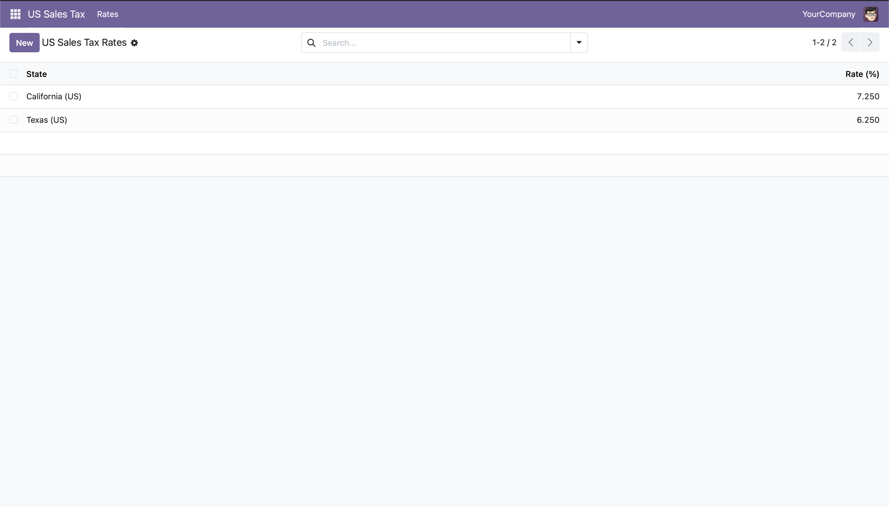

# US Sales Tax Rates (Odoo Module)

A custom Odoo 19 module for storing US state sales tax rates and computing the tax on an amount. Built to learn Odoo's module structure, ORM, views, access rules, and testing framework.



## Features

- **Tax rate model** linked to Odoo's built-in `res.country.state` table, limited to US states
- **Validation** that rejects rates outside 0–20% whenever a record is saved
- **`compute_tax(amount)`** method that returns the tax rounded to cents
- **List and form views** with its own app menu
- **Archiving** instead of deleting, using Odoo's `active` field convention
- **Unit tests** for tax computation and invalid-rate rejection

## Tech stack

Python · Odoo 19 ORM · PostgreSQL · XML views · Docker Compose

## Project structure

```
odoo-us-sales-tax/
├── docker-compose.yml          # Odoo + PostgreSQL containers
└── addons/
    └── us_sales_tax/
        ├── __manifest__.py     # Module metadata and data files
        ├── models/
        │   └── us_sales_tax.py # Model, validation, compute_tax()
        ├── security/
        │   └── ir.model.access.csv
        ├── views/
        │   └── us_sales_tax_views.xml
        └── tests/
            └── test_us_sales_tax.py
```

## Running it locally

Requires [Docker Desktop](https://www.docker.com/products/docker-desktop/).

1. Clone the repo and start the containers:

   ```bash
   git clone https://github.com/nbchen98/odoo-us-sales-tax.git
   cd odoo-us-sales-tax
   docker compose up
   ```

2. Open http://localhost:8069 and create a database named `dev`.
3. Turn on Developer Mode (Settings → bottom of the page).
4. Go to **Apps → Update Apps List**, search for **US Sales Tax**, and install it.

## Running the tests

```bash
docker compose run --rm odoo odoo -d dev -u us_sales_tax --test-enable --stop-after-init
```

A passing run ends with `0 failed, 0 error(s) of 2 tests`.

## Design notes

- **Many2one instead of a text field:** linking to Odoo's state records avoids typos and duplicate state names, and lets other modules join on the same data.
- **Constraint in the model, not the view:** `@api.constrains` enforces the rate range no matter how a record is created, whether through the UI, an import, or code.
- **Access rules:** `ir.model.access.csv` grants internal users full access; without it, Odoo hides the model entirely.

## Possible next steps

- Apply the rate to invoice lines in Odoo's Accounting app
- Support county and city rates layered on top of the state rate
- Import rates from a CSV file